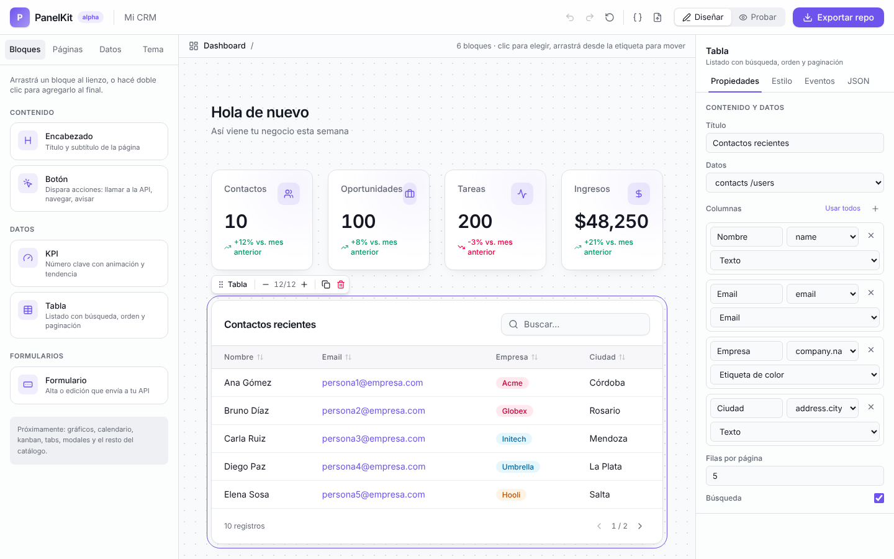
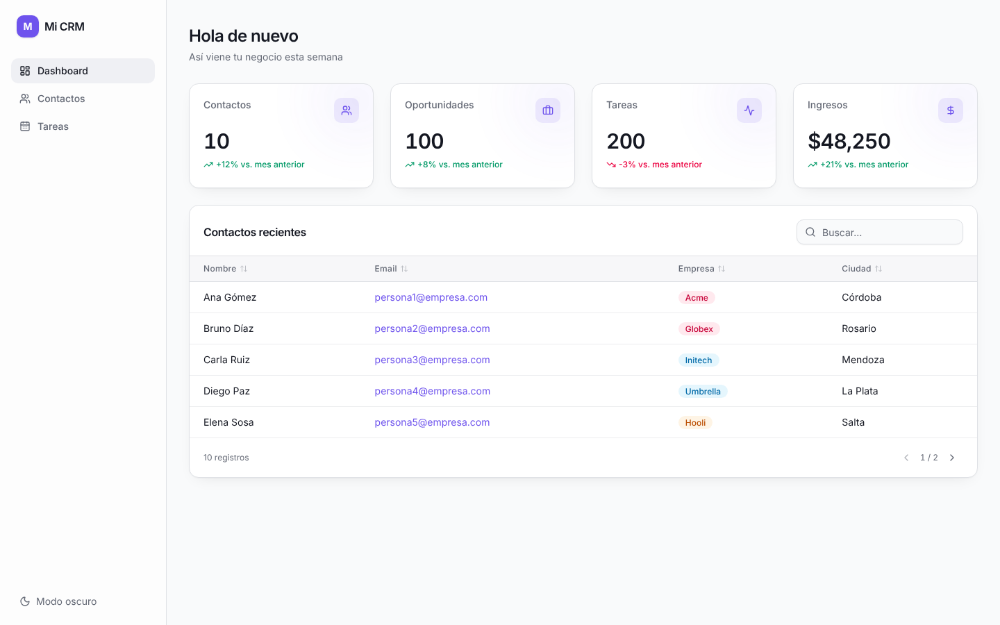
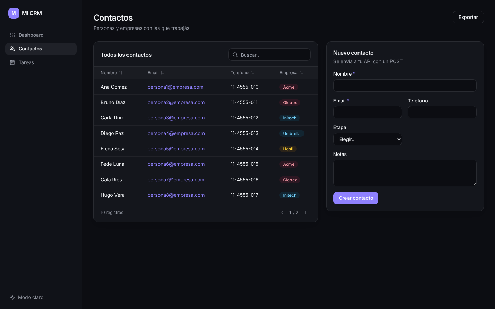

# PanelKit

**Build CRMs and internal tools by dragging blocks. Export a real React repo you own.**

PanelKit is an open-source visual builder. Drop tables, KPIs, forms and buttons on a canvas, connect them to your REST API, wire up events (call the API, navigate, show a toast) and validations, then click **Exportar repo** to download a clean React + Vite + Tailwind project. No runtime, no lock-in: the code is yours.

> Status: **alpha**. The editor UI is in Spanish first; English is coming.
> 🇦🇷 [Leer en español](#en-español)



## Why

Tools like Retool, Appsmith or ToolJet are great until you want to leave: your app lives inside their platform. Admin templates give you code but no builder and no data wiring. PanelKit sits in between: design visually, then walk away with a normal repository.

## What you get

- **Drag & drop canvas** on a 12-column grid, multiple pages, undo/redo.
- **Blocks:** KPI card (animated count-up), data table (search, sort, pagination), form (validations: required, min/max, length, regex, custom message), button, page header.
- **Data:** add a REST API, test a query, and PanelKit infers the fields so you map them with dropdowns. Secrets stay as `{{env.API_TOKEN}}` and end up in `.env.example`.
- **Events:** each block exposes events (`onSubmit`, `onRowClick`, `onClick`) that run a list of actions: call an API, navigate, show a toast, refresh data, open a link.
- **Style:** per-block spacing, background, alignment, shadow, or raw Tailwind classes. Theme accent, radius and light/dark mode.
- **Everything is JSON.** The whole app is one `panelkit.json` you can read, edit, paste or version.
- **Modern defaults:** Tailwind v4 tokens in OKLCH, Inter, Motion animations (staggered entrance, page transitions, animated numbers, toasts, skeletons).

## The exported app




Every export is a plain project: React 19, Vite, Tailwind CSS v4, TanStack Query, React Router, Motion and lucide-react. Events become readable code:

```tsx
<EntityForm
  title="Nuevo contacto"
  fields={[{ name: 'email', label: 'Email', type: 'email', required: true }]}
  onSubmit={async (values) => {
    await demoApi.request('POST', '/users', values)
    toast(tpl('Contacto {{values.name}} creado', { values }), 'success')
    await queryClient.invalidateQueries()
  }}
/>
```

## Run it

```bash
pnpm install
pnpm dev          # editor on http://localhost:5173
pnpm test         # schema + exporter tests
pnpm export:sample  # writes the CRM template as a repo to .out/mi-crm
```

## How it works

```
Canvas ──edits──▶ panelkit.json ──read by──▶ Exporter ──▶ React repo (.zip)
                      ▲
     Data sources ────┘ (fields + bindings)
```

| Package | Role |
| --- | --- |
| `packages/schema` | Zod schema for the project file: pages, blocks, data sources, queries, events, styles |
| `packages/blocks` | Runtime React blocks. Rendered live in the editor **and copied verbatim** into every export |
| `packages/exporter` | Block registry (props, events, panel fields) and the code generator |
| `apps/editor` | The visual builder |

Adding a block = one component in `packages/blocks` + one entry in `packages/exporter/src/registry.ts`.

## Roadmap

- [x] Canvas, pages, REST data, field mapping, events, validations, styles, JSON view, export
- [ ] Charts (line, bar, area, pie, then the rest), tabs, modal, alerts, badges
- [ ] Calendar, kanban, contacts and tasks modules; page templates (profile, invoice, pricing)
- [ ] Optional backend for direct database connections (Postgres, MySQL, Supabase)
- [ ] Auth and roles in exported apps
- [ ] Angular export target
- [ ] English UI

## Contributing

Issues and PRs welcome, especially new blocks. Run `pnpm typecheck && pnpm test` before opening a PR.

## En español

PanelKit es un constructor visual open source para armar CRMs y sistemas internos arrastrando bloques. Conectás tu API, asignás los campos a cada componente, configurás eventos, validaciones y estilos, y exportás un repositorio React que es tuyo. Todo el sistema vive en un único archivo JSON.

## License

[MIT](LICENSE)
